 
 
<picture><source media="(prefers-color-scheme: dark)" srcset="./cards/title-about-dark.svg" /></picture> 
 
<picture><source media="(prefers-color-scheme: dark)" srcset="./cards/title-stack-dark.svg" /></picture> 
 
<picture><source media="(prefers-color-scheme: dark)" srcset="./cards/title-cycle-dark.svg" /></picture> 
 
 
 
<picture><source media="(prefers-color-scheme: dark)" srcset="./cards/title-achieved-dark.svg" /></picture> 
 
<picture><source media="(prefers-color-scheme: dark)" srcset="./cards/title-coding-dark.svg" /></picture> 
 
<picture><source media="(prefers-color-scheme: dark)" srcset="./cards/title-contact-dark.svg" /></picture> 
 
 

